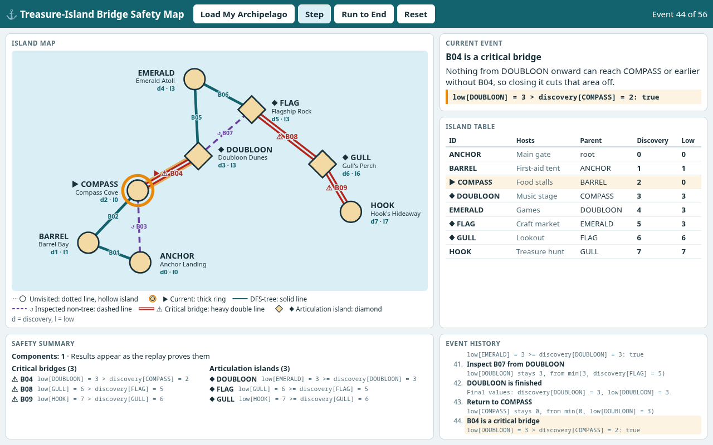

# Treasure-Island Bridge Safety Map

A local web app for volunteers running a festival across small islands. It turns an island-and-footbridge plan into an interactive map, replays how the network is inspected, and shows which single bridge or island could split the festival, with the numbers that prove it.



## Run it

You need Node.js (tested on version 26). The app itself has no dependencies, so there's nothing to install.

```
npm start
```

Then open <http://localhost:8000/>.

| Control | What it does |
|---|---|
| **Load My Archipelago** | Loads the map, with everything unvisited |
| **Step** | Advances exactly one event. Pressing it mid-animation completes that event and starts the next. |
| **Run to End** | Plays every remaining event, about 20 seconds in total. While it plays, the button reads **Skip to End**. |
| **Reset** | Returns to the loaded map, with everything unvisited |

The page follows your browser's light or dark setting. No box moves or resizes as the replay steps, so each value stays where you last saw it.

## Explaining a result

Three moments in the replay show every rule. Each one can be read from the screen alone.

| Event | Result | Why |
|---|---|---|
| 44 | **B04 is a critical bridge** | `low[DOUBLOON] = 3 > discovery[COMPASS] = 2`. Nothing from DOUBLOON onward can reach COMPASS or earlier without B04, so closing it cuts the music stage side off from the first-aid tent. |
| 39 | **B05 is not a bridge** | `low[EMERALD] = 3 > discovery[DOUBLOON] = 3` is false, because B07 gives EMERALD's side another route back to DOUBLOON. |
| 40 | **DOUBLOON is an articulation island** | `low[EMERALD] = 3 >= discovery[DOUBLOON] = 3`. That other route still ends at DOUBLOON, so losing the island itself cuts the branch off. |

**Final result:** 1 component, bridges B04, B08 and B09, and articulation islands COMPASS, DOUBLOON, FLAG and GULL.

## How it works

**Calculate once, then replay.** The engine validates the graph and runs the whole search up front. Each event records what happened and holds a full snapshot of the state after it. The interface never calculates anything: it holds a position in the list and draws that event's snapshot.

```
archipelago data
      │
      ▼
validateGraph ──invalid──▶ errors only, with no partial analysis
      │ valid
      ▼
GraphState            read-only: islands, bridges, sorted adjacency
      │
      ▼
runLowLink            one event list, each event with a full snapshot
      │
      ▼
Replay                one position in that list; Step, Run to End and Reset only move it
      │
      ▼
Player                decides when the screen redraws
      │
      ▼
map, table, current event, summary, history    all drawn from one view
```

This is what keeps everything in sync: there is one event list and one position, and no panel keeps its own copy of a value. Animation sits on top and only reads events, so it can't change the results.

| Folder | Contents |
|---|---|
| `src/engine/` | Validation, `GraphState` and the low-link traversal |
| `src/replay.js`, `src/player.js` | The position in the replay, and when the screen updates |
| `src/ui/` | The map, panels and animation |
| `src/archipelago/` | The demo map |
| `scripts/layout.js` | Generates the island positions during development |
| `test/`, `fixtures/` | Tests and their hand-typed expected values |
| `docs/` | The documents listed below |

## Main technical decisions

The commit history explains each decision in the commit that made it.

| Decision | Why | Rejected |
|---|---|---|
| Plain JavaScript, with no build step | The same files run in the browser and in tests | A framework: too much for one map and a few panels |
| SVG for the map | At most 12 islands and 20 bridges, with dashes and shapes built in | Canvas, WebGL, graph libraries: they mostly solve scale we don't need |
| graphology ForceAtlas2, run once and saved | Rerunning one command is quicker than placing islands by hand, and the map can't shift | Calculating in the browser: adds a dependency, and the brief requires positions before validation |
| Full snapshots in each event | Going to any state means drawing one snapshot, with no second copy of the rules | Undo logic, replaying events from the start |
| `requestAnimationFrame` for animation | Moving a marker along a straight line is simple interpolation | An animation library: a dependency for one small helper |
| `prefers-color-scheme` on the existing colour tokens | The browser already knows the viewer's choice, and one block recolours everything | A theme switch: a control and saved state for something the browser already answers |
| Fixed row heights and table column widths | Nothing moves between steps, however long the text is | Sizing boxes from their contents: the table moved up and down at each step |

## Documents

| File | Contents |
|---|---|
| [`docs/ORACLE.md`](docs/ORACLE.md) | Expected answers, written before the engine and never read by the app |
| [`docs/EVENTS.md`](docs/EVENTS.md) | Event schema, emission order and the hand-derived 56-event sequence |
| [`docs/PLAN.md`](docs/PLAN.md) | The approved plan |
| [`docs/PROMPTS.md`](docs/PROMPTS.md) | Prompts used, how the plan changed, and mistakes caught along the way |

## Test evidence

| Check | Result | Rerun with |
|---|---|---|
| Automated tests | 151 of 151 pass ([output](docs/evidence/test-output.txt)) | `npm ci && npm test` |
| Independent answers | All 4 graphs agree with brute force | `python3 docs/oracle-check.py` |
| Mutation check: breaks the code on purpose | 19 of 19 caught ([output](docs/evidence/mutation-check.txt)) | `node docs/evidence/mutation-check.mjs` |
| Browser walkthrough in Chrome | 67 of 67 pass ([output](docs/evidence/browser-walkthrough.txt), [screenshots](docs/evidence/screenshots/)) | `npm install --no-save playwright-core && node docs/evidence/browser-walkthrough.mjs` |

The tests also compare the engine with brute-force removal on 500 repeatable random graphs.

Animation runs only in the browser, so the walkthrough covers it. It compares every animated state with an unanimated control run, including rapid Step presses and Reset mid-animation.

The walkthrough also checks both colour themes, including measured contrast. At 8 window sizes, it checks that no box or table column moves at any event.

## Changing the map

1. Edit `src/archipelago/topology.js`.
2. Run `npm run layout` to regenerate the positions.
3. Update the expected values in `fixtures/graphs.js`, `test/events.test.js` and the tests that name specific islands, along with `docs/ORACLE.md` and `docs/EVENTS.md`.

Until step 3 is done, tests pinned to the documented map fail on purpose. Adding one island in a rehearsal failed 22 of the 151 tests, and the app itself worked correctly.

## Not included

There is no graph editor, upload, Back button, speed control, Pause button, theme switch, saved data or backend, as none of them is required. Invalid graphs are demonstrated through tests, which the brief allows. If the demo data itself were invalid, the page would show the validation errors.

## Known limits

- **Small map text on small screens:** the map scales to fit its panel, so bridge labels are about 10px at 1536x738, 7.7px at 1366x650 and about 5px on a phone. The table and summary show the same values at a readable size.
- **Short windows:** below about 650px tall, or 688px when the window is under 1366px wide, the island table scrolls inside its box. Nothing moves, but not every island shows at once.
- **Narrow windows:** widths below 360px weren't tested, and long text may need more room than is reserved there. At 1000px wide, the final summary scrolls by a few pixels inside its box.
- **The ↺ symbol:** it renders small in some system fonts. The dashed line and the legend carry the same meaning.
